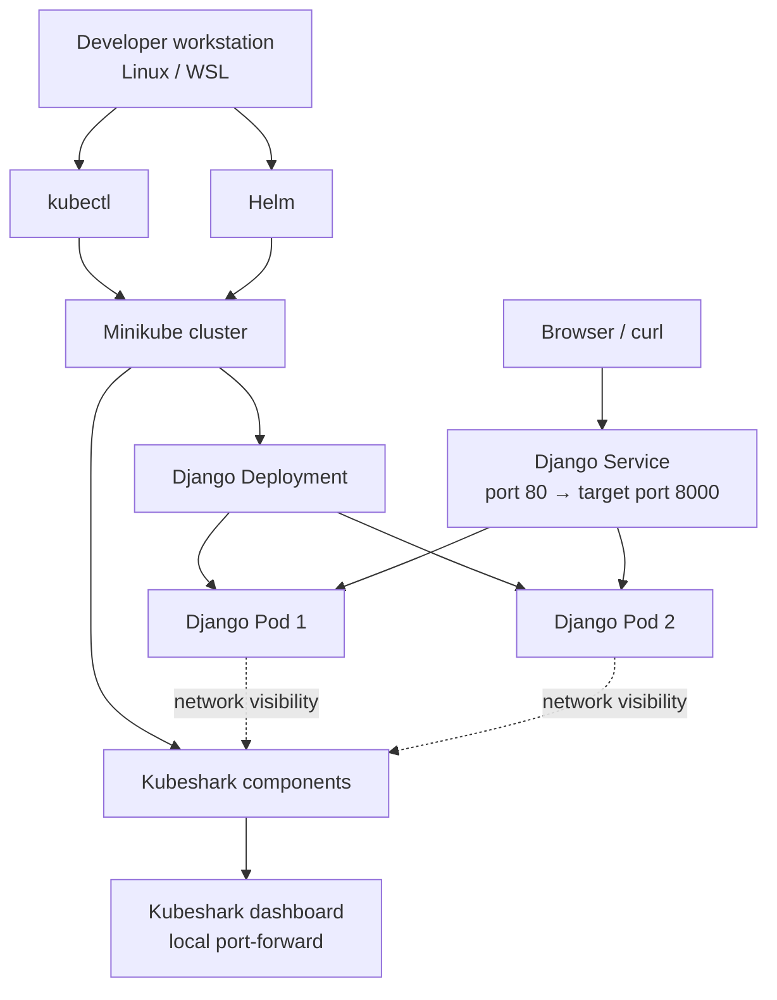

<div align="center">

# Django on Kubernetes with Kubeshark Monitoring

**A hands-on project for deploying a containerized Django application to a local Kubernetes cluster and exploring network visibility with Kubeshark.**


</div>

---

## Project overview

This project brings together a small Django web application, Kubernetes deployment manifests, Minikube, and Kubeshark. The application is packaged as a container image and deployed to Kubernetes, where a Deployment manages replicas and a Service provides a stable way to reach the application. Kubeshark is installed in the cluster to explore pod-level network traffic and service communication.

The goal is to practise the workflow an engineer uses when moving from a local container to a Kubernetes workload: define resources as YAML, deploy them with `kubectl`, verify pod and service health, access the application, and investigate network visibility.

> **Current environment note:** The Django Deployment and Service manifests are present in this repository, and the captured cluster output showed two application replicas running. The Kubeshark dashboard and hub were also deployed, but the screenshots show a connectivity/licence-verification issue reaching `api.kubeshark.com`. The README documents that limitation rather than presenting traffic capture as fully verified.

## What this project covers

- Container image usage for a Django/Python application.
- Kubernetes Deployments, Pods, labels, selectors, and Services.
- Local Kubernetes practice with Minikube and `kubectl`.
- Application access through a Kubernetes Service and Minikube port-forwarding.
- Installing Kubeshark with Helm and opening its local dashboard.
- Reviewing pod status, service endpoints, logs, and cluster events when troubleshooting.
- Organising deployment configuration and evidence for a reproducible GitHub portfolio.

## Architecture



The diagram describes the intended design. Actual resource names and port mappings should always be checked against the YAML files in this repository before applying changes.

## Technology stack

| Technology | Purpose in this project |
|---|---|
| Python / Django | Web application running in the container |
| Docker | Builds and runs the application image |
| Kubernetes | Schedules application Pods and maintains the desired replica count |
| Minikube | Provides a local Kubernetes cluster for development and testing |
| `kubectl` | Applies manifests and inspects cluster resources |
| Helm | Installs and manages the Kubeshark chart |
| Kubeshark | Provides a dashboard for inspecting Kubernetes network traffic |
| YAML | Defines Kubernetes Deployment and Service resources |
| Git / GitHub | Source control and project portfolio |

## Repository structure

The layout below reflects the files shown in the current project. The root directory also contains `deployment.yml` and `pod.yml`; the `kubernetes/` directory contains the Django-specific manifests.

```text
django-kubernetes-kubeshark-monitoring/
├── .gitignore
├── deployment.yml
├── pod.yml
├── kubernetes/
│   ├── django-deployment.yaml
│   └── django-service.yaml
├── monitoring/
├── README.md
└── docs/
    └── screenshots/
        ├── 01-kubeshark-dashboard.png
        ├── 02-kubeshark-dashboard-targets.png
        ├── 03-kubernetes-workloads.png
        ├── 04-django-deployment-manifest.png
        ├── 05-django-service-manifest.png
        └── 06-kubeshark-connectivity-diagnostics.png
```

> Keep the actual directory layout in sync with this section as the project evolves. If `monitoring/` contains additional manifests or configuration, add those filenames here.

## Screenshots and implementation evidence

### 1. Kubeshark dashboard

The dashboard was opened through a local port-forward. The captured view currently shows the dashboard attempting to reconnect; it is useful evidence of the installed UI, but not proof that traffic is being captured successfully.


### 2. Pod targeting in Kubeshark

Kubeshark lists pods that are not currently selected by its targeting configuration. The Django application pods need to be included in the target selection before they can be used as the intended capture target.


### 3. Kubernetes workloads

Use this view as a reference for checking the workloads deployed in the cluster. The important checks are that the application Deployment has the expected ready replicas and that the Kubeshark components are running.


### 4. Django Deployment manifest

The Deployment declares the application image, container port, labels, and desired replica count. A Deployment is preferred over a standalone Pod for this workload because Kubernetes can replace failed or deleted Pods to maintain the declared state.


### 5. Django Service manifest

The Service selects Pods using their labels and exposes the application through a stable Kubernetes endpoint. In the captured manifest, the Service maps port `80` to the application container's target port `8000`.


### 6. Kubeshark connectivity diagnostics

The logs show attempts to reach Kubeshark's external API failing during DNS resolution, along with licence-verification errors. This is an environment/connectivity issue to resolve before claiming end-to-end traffic inspection has been validated.


## Prerequisites

Install and verify the following tools on Linux or Ubuntu under WSL:

- Docker Engine or Docker Desktop with WSL integration enabled.
- Minikube.
- `kubectl`.
- Helm.
- Git.
- Internet and DNS access for downloading images and verifying Kubeshark's licence.

Check the installed tools:

```bash
docker --version
docker info
minikube version
kubectl version --client
helm version
git --version
```

For a local Minikube cluster using Docker, the Docker daemon must be available first.

## Getting started

### 1. Start and verify Minikube

```bash
minikube start --driver=docker
minikube status
kubectl get nodes
```

The Minikube node should report `Ready` before deploying or troubleshooting workloads. If Minikube reports an unsupported or empty driver, explicitly specify `--driver=docker` and confirm Docker is running. Do not delete an existing profile unless its data is no longer needed.

### 2. Review the manifests

From the repository root:

```bash
find . -maxdepth 3 -type f \
  -not -path './.git/*' \
  -not -path './minikube-linux-amd64' | sort
```

Review the application Deployment and Service:

```bash
cat kubernetes/django-deployment.yaml
cat kubernetes/django-service.yaml
```

Before applying them, confirm that the container image name exists and is accessible to Minikube. If the image is built locally, ensure Minikube can access it; if it is stored in a registry, confirm the tag and pull permissions.

### 3. Deploy the Django application

Apply the manifests from the repository root:

```bash
kubectl apply -f kubernetes/django-deployment.yaml
kubectl apply -f kubernetes/django-service.yaml
```

Check rollout and resource state:

```bash
kubectl rollout status deployment/sample-python-app
kubectl get deployments
kubectl get pods -l app=sample-python-app -o wide
kubectl get services
kubectl get endpoints python-django-app-service
```

The Deployment name and Service name above match the names visible in the captured environment. If you change the manifests, use the names defined in your own files.

### 4. Access the Django application

Start a local Service tunnel:

```bash
minikube service python-django-app-service --url
```

Use the URL returned by Minikube. Keep the command running if it establishes a tunnel, then open the URL in a browser. Alternatively, use port-forwarding:

```bash
kubectl port-forward service/python-django-app-service 8000:80
```

Then browse to `http://127.0.0.1:8000`. If your Service port differs from `80`, adjust the command to match the manifest.

### 5. Install Kubeshark with Helm

If Kubeshark is not already installed, add its Helm repository and update chart metadata:

```bash
helm repo add kubeshark https://helm.kubeshark.com
helm repo update
```

Install it into its own namespace:

```bash
helm install kubeshark kubeshark/kubeshark \
  --namespace kubeshark \
  --create-namespace
```

If the release already exists, inspect it instead of running the install command again:

```bash
helm list -n kubeshark
kubectl get pods -n kubeshark -o wide
kubectl get services -n kubeshark
```

### 6. Open the Kubeshark dashboard

Forward the dashboard service to a local port:

```bash
kubectl port-forward -n kubeshark service/kubeshark-front 8899:80
```

Open [http://127.0.0.1:8899](http://127.0.0.1:8899) in your browser and keep the port-forward terminal open.

**Security note:** Keep this dashboard bound to localhost unless you have deliberately configured authentication and network restrictions. Do not expose an unauthenticated traffic-inspection dashboard to a public network.

### 7. Target the Django application pods

In the Kubeshark UI, open the targeting configuration and include the `default` namespace and the Django application Pods. A pod-name pattern such as `sample-python-app-.*` may match the current Deployment-generated Pod names; verify the actual names first:

```bash
kubectl get pods -n default -l app=sample-python-app
```

Pod names can change after a rollout, so a label- or namespace-based targeting option is preferable when supported by the installed Kubeshark version. Apply the target configuration in the UI and generate application requests while observing the dashboard.

## Validation checklist

Use this checklist to record evidence as the project is completed:

- [ ] Minikube starts successfully and its node reports `Ready`.
- [ ] The Django Deployment reaches its desired ready replica count.
- [ ] The Service has endpoints that point to the application Pods.
- [ ] The Django page responds through the Service URL or port-forward.
- [ ] Kubeshark frontend, hub, and worker components are running.
- [ ] The Django Pods are included in Kubeshark's target configuration.
- [ ] Test requests appear in Kubeshark's traffic view.
- [ ] Screenshots show the successful application response and captured traffic.

Only mark the final two items complete after confirming the traffic is visible in the dashboard.

## Troubleshooting notes

### Minikube reports `DRV_UNSUPPORTED_OS` or an unsupported driver

The current profile may have been created with an invalid or unavailable driver. Check Docker first:

```bash
docker info
```

Then try:

```bash
minikube start --driver=docker
```

If Docker is unavailable, fix Docker/WSL integration before retrying.

### A Kubernetes node is `NotReady`

```bash
kubectl get nodes
kubectl describe node minikube
kubectl get pods -A
```

Check the node conditions, events, and system Pods. Resolve node readiness before investigating application-level symptoms.

### The Django Service has no endpoints

```bash
kubectl get pods -l app=sample-python-app --show-labels
kubectl describe service python-django-app-service
kubectl get endpoints python-django-app-service
```

The Service selector must match the labels on the application Pods. Confirm that the container listens on the target port declared by the Service.

### Kubeshark dashboard displays “Retrying connection”

Inspect pod readiness, endpoints, and logs:

```bash
kubectl get pods -n kubeshark -o wide
kubectl get endpoints -n kubeshark
kubectl logs deployment/kubeshark-hub -n kubeshark --tail=80
kubectl logs deployment/kubeshark-front -n kubeshark --tail=80
```

If logs show DNS failures for `api.kubeshark.com` or licence verification errors, verify host and cluster DNS and outbound internet access. The screenshot in this repository records that issue in the current environment; it should not be interpreted as successful traffic capture.

## Security and repository hygiene

Before pushing the project to GitHub:

- Never commit `.env` files, passwords, API tokens, private keys, or kubeconfig credentials.
- Do not commit the downloaded `minikube-linux-amd64` binary.
- Avoid including private or customer traffic in screenshots.
- Review `git status` before each commit.
- Keep the dashboard local unless access control and network restrictions are in place.

A suitable `.gitignore` baseline is:

```gitignore
# Local tools and environment
minikube-linux-amd64
.env
.env.*
!.env.example
venv/
.venv/
__pycache__/
*.py[cod]

# Local editor and OS files
.vscode/
.idea/
.DS_Store
Thumbs.db
```

Keep any project-specific exclusions already present in your `.gitignore`.

## What I learned

This project provides practical experience with:

- Writing and applying Kubernetes YAML manifests.
- Using Deployments and Services to run and expose a web application.
- Verifying application health through Pod status, rollout state, and Service endpoints.
- Operating a local Kubernetes cluster with Minikube.
- Installing a Kubernetes observability tool with Helm.
- Investigating a dashboard connection problem by checking logs, endpoints, DNS, and outbound connectivity.
- Maintaining an evidence-based technical README for a GitHub portfolio.

## Next improvements

- Add an application architecture diagram based on the final manifests.
- Capture a clean screenshot of the Django page responding successfully.
- Capture a successful Kubeshark traffic view after resolving the current connectivity issue.
- Add readiness and liveness probes plus resource requests and limits.
- Add automated YAML validation in GitHub Actions.
- Document a repeatable local build process for the Django container image.

## References

- [Kubernetes documentation](https://kubernetes.io/docs/)
- [Minikube documentation](https://minikube.sigs.k8s.io/docs/)
- [kubectl command reference](https://kubernetes.io/docs/reference/kubectl/)
- [Kubernetes Deployments](https://kubernetes.io/docs/concepts/workloads/controllers/deployment/)
- [Kubernetes Services](https://kubernetes.io/docs/concepts/services-networking/service/)
- [Helm documentation](https://helm.sh/docs/)
- [Kubeshark documentation](https://docs.kubeshark.com/)

---

*This repository documents a hands-on local Kubernetes project. The screenshots are included as implementation evidence, and outstanding environment issues are called out transparently so the project can be reproduced and improved.*
