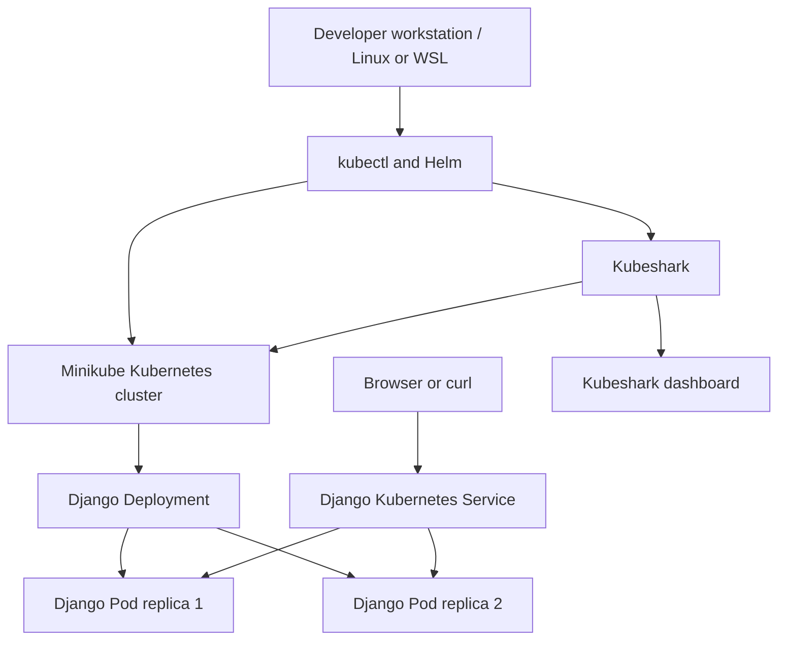

# Django on Kubernetes with Kubeshark Monitoring

A hands-on project that deploys a Django web application to a local Kubernetes cluster with Minikube and documents how Kubeshark can be used to inspect Kubernetes network traffic.

The goal is to demonstrate practical skills in containerized application deployment, Kubernetes manifests, service exposure, cluster troubleshooting, and network observability.

> **Documentation note:** The images in `images/` are illustrative panels created for this README. Treat them as visual guides, not as independently verified terminal output. Kubernetes service type, ports, pod names, and dashboard screens can differ in your environment. Use your actual manifests and live command output as the source of truth.

## Project overview

This project brings together:

- **Django** — the sample web application.
- **Kubernetes** — manages the application workload and service.
- **Minikube** — runs a local Kubernetes cluster for development and testing.
- **kubectl** — applies manifests and inspects cluster resources.
- **Helm** — installs Kubeshark from its Helm chart.
- **Kubeshark** — provides a dashboard for selecting workloads and observing network traffic.

## Architecture



The Deployment maintains the desired number of application replicas. The Service selects the matching Pods and provides a stable access point. Kubeshark is installed separately in the `kubeshark` namespace and can be configured to target the application Pods for traffic inspection.

## Visual walkthrough

### 1. Repository structure

Keep Kubernetes manifests together in a dedicated directory. A practical structure for this repository is:

```text
django-kubernetes-kubeshark-monitoring/
├── .gitignore
├── README.md
├── deployment.yml
├── pod.yml
├── kubernetes/
│   ├── django-deployment.yaml
│   └── django-service.yaml
└── images/
    ├── 01-project-structure.png
    ├── 02-minikube-status.png
    ├── 03-kubernetes-workloads.png
    ├── 04-django-deployment.png
    ├── 05-django-service.png
    ├── 06-django-browser.png
    ├── 07-kubeshark-installation.png
    ├── 08-kubeshark-dashboard.png
    └── 09-kubeshark-pod-targeting.png
```

If `deployment.yml` or `pod.yml` is an older experiment, either document its purpose or remove it after confirming it is no longer needed. Avoid keeping multiple manifests that deploy the same application with conflicting labels, ports, or resource names.


### 2. Start and verify Minikube

Start Minikube with a driver supported by your environment. For example, on a Linux environment where Docker is installed and running:

```bash
minikube start --driver=docker
kubectl get nodes
kubectl get pods -A
```

The node should report `Ready` before you rely on the cluster for deployments or packet capture.


**Troubleshooting tip:** If Minikube reports `DRV_UNSUPPORTED_OS` or an empty driver, specify a supported driver explicitly, such as `--driver=docker`, and verify Docker is running. Do not delete the cluster or reinstall components until you have checked the current status and driver configuration.

### 3. Inspect Kubernetes workloads

Use these commands to review the application and monitoring components:

```bash
kubectl get deployments -A
kubectl get pods -A -o wide
kubectl get services -A
```

Confirm that the Django Deployment has the expected number of ready replicas and that the Kubeshark components are running in the `kubeshark` namespace.


### 4. Django Deployment manifest

The Deployment describes the desired application replica count, Pod labels, container image, and container port. Labels and selectors must match so the Service can find the application Pods.

Example structure (adjust the image and container port to match your application):

```yaml
apiVersion: apps/v1
kind: Deployment
metadata:
  name: django-app
spec:
  replicas: 2
  selector:
    matchLabels:
      app: sample-python-app
  template:
    metadata:
      labels:
        app: sample-python-app
    spec:
      containers:
        - name: django-app
          image: YOUR_DJANGO_IMAGE
          ports:
            - containerPort: 8000
```

Replace `YOUR_DJANGO_IMAGE` with the image you actually built and made available to Minikube. Do not apply this example unchanged if your existing `kubernetes/django-deployment.yaml` already contains the correct image and settings.


Apply the manifest and verify the rollout:

```bash
kubectl apply -f kubernetes/django-deployment.yaml
kubectl rollout status deployment
kubectl get pods -l app=sample-python-app
```

If your Deployment is named `sample-python-app`, you can use the specific command `kubectl rollout status deployment/sample-python-app`.

### 5. Django Service manifest

The Service selects Pods using labels and maps a service port to the application container port. The screenshot below is a visual reference; use the service type and port values from your actual manifest.


Inspect the live Service before accessing the app:

```bash
kubectl get service
kubectl describe service python-django-app-service
kubectl get endpoints python-django-app-service
```

A Service with no endpoints usually means its selector does not match the Pod labels, or the Pods are not ready.

For a Minikube LoadBalancer service, try:

```bash
minikube service python-django-app-service --url
```

Keep the terminal running if Minikube indicates that it is maintaining a tunnel. Open the URL printed by the command in your browser. The exact service name must match the name in your manifest.

### 6. Verify the Django application

Once the Service is reachable, load the application in a browser or test the URL with `curl`:

```bash
curl -I <application-url>
```

Replace `<application-url>` with the URL returned by Minikube. A successful HTTP response confirms that the request reached an HTTP endpoint; also inspect the page and application logs to verify the Django app itself is behaving as expected.


Useful checks if the page does not load:

```bash
kubectl get pods -l app=sample-python-app
kubectl logs deployment/sample-python-app --tail=100
kubectl describe service python-django-app-service
```

Update resource names in these commands if your manifests use different names.

### 7. Install Kubeshark with Helm

Kubeshark is installed separately from the Django application. The following commands show the standard Helm workflow:

```bash
helm repo add kubeshark https://helm.kubeshark.com
helm repo update
helm install kubeshark kubeshark/kubeshark --namespace kubeshark --create-namespace
```

If the release already exists, do not run `helm install` again. Check its status first:

```bash
helm list -n kubeshark
kubectl get pods -n kubeshark
kubectl get services -n kubeshark
```


### 8. Open the Kubeshark dashboard

Forward the dashboard Service to your local machine:

```bash
kubectl port-forward -n kubeshark service/kubeshark-front 8899:80
```

Leave this command running and open:

```text
http://127.0.0.1:8899/
```


Keep the dashboard bound to localhost unless you have deliberately configured authentication and network access controls. Do not expose an unauthenticated monitoring dashboard to the public internet.

### 9. Select the Django Pods for capture

Kubeshark may initially show that there are no Pods matching its current target selection. In the dashboard, open the Pod targeting/selection view and select the Django application Pods in the `default` namespace. The names will vary as Kubernetes creates or replaces Pods.


You can list the current names with:

```bash
kubectl get pods -n default -l app=sample-python-app -o wide
```

After selecting the correct targets, generate application traffic by refreshing the Django page or sending a request with `curl`. Check the dashboard for captured traffic. Seeing the application Pods in Kubernetes does not by itself mean they are selected as Kubeshark capture targets.

### 10. Troubleshooting checklist

| Symptom | Checks |
|---|---|
| Minikube is `NotReady` | `minikube status`, `kubectl get nodes`, and the configured Minikube driver |
| Django Pods are not ready | `kubectl describe pod <pod-name>` and `kubectl logs <pod-name>` |
| Service has no endpoints | Compare Service selector labels with Pod labels and check Pod readiness |
| Browser cannot reach Django | Check the Service name/type and use `minikube service <service-name> --url` |
| Kubeshark dashboard does not connect | Check `kubectl get pods,svc,endpoints -n kubeshark` and the Hub/Front logs |
| Kubeshark says no Pods are targeted | Select the Django Pods in the dashboard's target selection |
| Kubeshark reports license or internet errors | Verify DNS and internet access from the environment where Kubeshark is running; follow the current vendor guidance for account/licensing requirements |

Useful Kubeshark diagnostics:

```bash
kubectl get pods -n kubeshark -o wide
kubectl get services -n kubeshark
kubectl get endpoints -n kubeshark
kubectl logs deployment/kubeshark-hub -n kubeshark --tail=80
kubectl logs deployment/kubeshark-front -n kubeshark --tail=80
```

If the cluster itself is `NotReady`, address that first. Kubeshark's worker may not register correctly while the Kubernetes node is unhealthy.

## What this project demonstrates

- Deploying and checking a multi-replica application in Kubernetes.
- Using labels, selectors, Deployments, and Services.
- Accessing a local Kubernetes application through Minikube.
- Installing and inspecting a Helm-based observability tool.
- Selecting workloads for network traffic capture.
- Troubleshooting Pod readiness, Service endpoints, dashboard connectivity, and DNS/internet dependencies.
- Documenting infrastructure steps clearly for repeatable development and portfolio review.

## Next improvements

- Add a Dockerfile and reproducible image build steps for the Django app.
- Add readiness and liveness probes.
- Define CPU and memory requests/limits.
- Add Kubernetes resource cleanup instructions.
- Capture real terminal and dashboard screenshots from a healthy run, then replace the illustrative images in this repository.
- Add a short demo recording or a sample traffic-capture walkthrough.

## Cleanup

When you finish testing, remove only the resources created for this project:

```bash
kubectl delete -f kubernetes/django-service.yaml
kubectl delete -f kubernetes/django-deployment.yaml
helm uninstall kubeshark -n kubeshark
```

If other workloads share the `kubeshark` namespace or cluster, review the resources before deleting the namespace or stopping Minikube.

## Repository

Suggested repository name: **`django-kubernetes-kubeshark-monitoring`**

---

*Built as a hands-on learning project to practice Kubernetes deployment and application network observability.*

